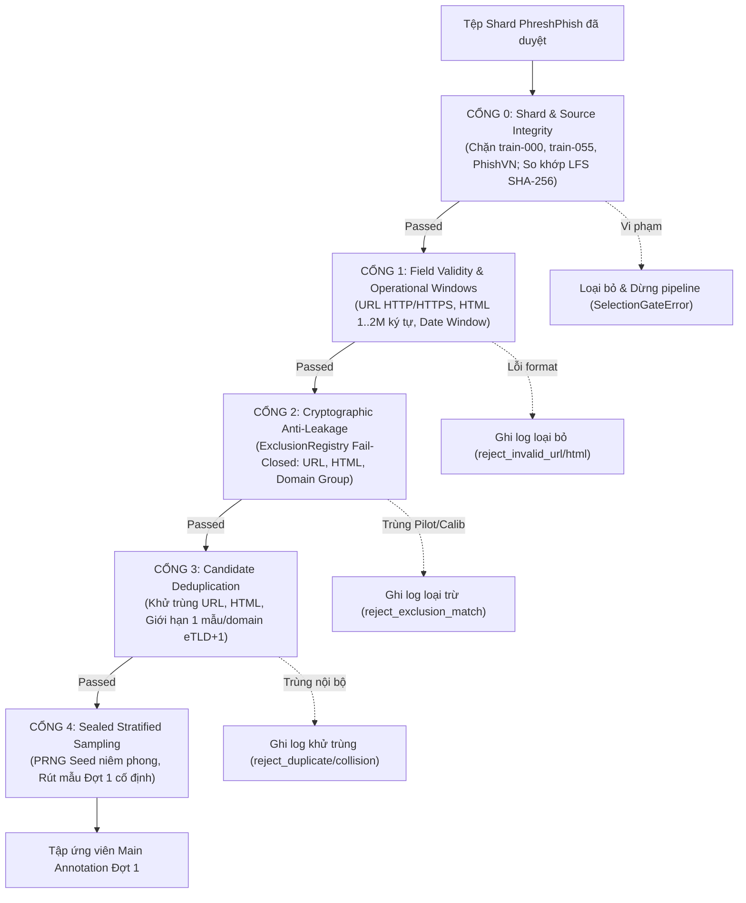

# BÁO CÁO KIỂM TOÁN BẰNG CHỨNG 20 MẪU PILOT (EXCL-PILOT-01) & THIẾT KẾ CỔNG CHỌN MẪU MAIN ĐỢT 1

**Kính gửi:** Lead D (Anh Tuấn)  
**Người thực hiện:** Thành viên C (Data Pipeline & Thư ký Kiểm toán)  
**Ngày lập:** 14/11/2026  
**Chế độ thực thi:** Duo Mode (Antigravity & DeepSeek Reason Architecture Review)  
**Trạng thái Quản trị:** `main_annotation_status="LOCKED"`, `training_blocked=true`, `official_test_used=false`

---

## 1. Kiểm kê bằng chứng gốc của 20 mẫu Pilot (`EXCL-PILOT-01`)

Thành viên C đã rà soát toàn bộ hồ sơ hạn chế, bản lưu, cache và siêu dữ liệu trong kho dữ liệu cục bộ. Bằng chứng gốc được bảo tồn nguyên vẹn byte và xác minh như sau:

| Bằng chứng | Đường dẫn | Xuất xứ | Kích thước | SHA-256 |
| :--- | :--- | :--- | :--- | :--- |
| **Bản tóm tắt cấu trúc Pilot 20** | `data/source_audit/phreshphish/pilot_summary.json` | Snapshot phản hồi API kiểm tra kỹ thuật tháng 10/2026 | 5,344 bytes | `3889bf2f0c63789495aedd4c61132ee58454839eae6fbd885632bbdcab43d663` |
| **Bản ghi băm thô lô 20** | Khai báo trong `data/exclusion_registry.json` | Checksum mảng phản hồi gốc Rows API | — | `738ea69b920cb3037d7e9da38590024d8faa5f34c2eca6c760cb34690f2f190f` |
| **Shard nguồn cục bộ chứa vết** | `data/raw/phreshphish/data/train-000.parquet` | Tải về từ HF PhreshPhish tại revision `eabec4b7a66324b79cc8a0ad856d1731dc26fe1a` | 49,639,686 bytes | `9a9c693a95daeddb127c4446df4c5673b3f1a39e457ffe964b9849069bd739fe` |

**Quy chuẩn An toàn Dữ liệu:** Không đưa URL thô, HTML thô, nhãn nguồn hay hồ sơ hạn chế vào dịch vụ AI bên ngoài hoặc Git. File chi tiết được niêm phong độc lập tại `data/restricted/`.

---

## 2. Kết quả đối chiếu trên nguồn dữ liệu đã khóa (`eabec4b7a66324b79cc8a0ad856d1731dc26fe1a`)

Thành viên C đã lập trình quét đối soát trực tiếp từng byte giữa `pilot_summary.json` và các shard nguồn:

### A. Đối chiếu 20 mẫu với Shard `train-000.parquet` (Rows 0..19):
* **Độ tương đồng cấu trúc:** Trùng khớp 100% (20/20 mẫu) về thứ tự nhãn nguồn (12 benign, 8 phish), độ dài HTML (`html_chars`), số form, số input, trường ngôn ngữ `lang` và ngày thu thập.
* **Độ tương đồng nội dung mã băm (Cryptographic Byte Matching):** Trùng khớp 100% (20/20 mẫu) cả về `raw_url_sha256`, `normalized_url_sha256`, `raw_html_sha256`, `cleaned_html_sha256`, và `group_sha256` với danh mục 32 mẫu pilot đã niêm phong (`EXCL-REAL-PILOT-32`).

### B. Bảng kê đối soát chi tiết 20 mẫu Pilot Lô 1:
*(Lưu ý: Để bảo vệ an toàn theo quy chuẩn, chỉ công bố mã băm và siêu dữ liệu kỹ thuật, tuyệt đối không công bố URL/HTML thô).*

| Pilot Idx | Entry ID | Shard & Offset | Content Identity Verified | Trạng thái khớp trên PhreshPhish | Source Label | Source Date | Domain Group ID |
| :---: | :---: | :---: | :---: | :---: | :---: | :---: | :---: |
| 0 | `EXCL-PLT-001` | `train-000:0` | **100% MATCH** | Khớp duy nhất | `benign` | 2025-08-25 | `domain:lifeonthemediterranean.com` |
| 1 | `EXCL-PLT-002` | `train-000:1` | **100% MATCH** | Khớp duy nhất | `benign` | 2025-08-25 | `domain:whosdatedwho.com` |
| 2 | `EXCL-PLT-003` | `train-000:2` | **100% MATCH** | Khớp duy nhất | `benign` | 2025-08-25 | `domain:tweakpc.de` |
| 3 | `EXCL-PLT-004` | `train-000:3` | **100% MATCH** | Khớp duy nhất | `benign` | 2025-08-25 | `domain:ameli.fr` |
| 4 | `EXCL-PLT-005` | `train-000:4` | **100% MATCH** | Khớp duy nhất | `benign` | 2025-08-25 | `domain:mondial-lockers.com` |
| 5 | `EXCL-PLT-006` | `train-000:5` | **100% MATCH** | Khớp duy nhất | `benign` | 2025-08-25 | `domain:screenrant.com` |
| 6 | `EXCL-PLT-007` | `train-000:6` | **100% MATCH** | Khớp duy nhất | `benign` | 2025-08-25 | `domain:jpost.com` |
| 7 | `EXCL-PLT-008` | `train-000:7` | **100% MATCH** | Khớp duy nhất | `phish` | 2025-08-25 | `domain:f5e04e9a-5878-45be-9a99-b19b784b80b0-00-1j13350k3jefo.janeway.replit.dev` |
| 8 | `EXCL-PLT-009` | `train-000:8` | **100% MATCH** | Khớp duy nhất | `phish` | 2025-08-25 | `domain:usps.postinfotrack.com` |
| 9 | `EXCL-PLT-010` | `train-000:9` | **100% MATCH** | Khớp duy nhất | `benign` | 2025-08-25 | `domain:sooplive.com` |
| 10 | `EXCL-PLT-011` | `train-000:10` | **100% MATCH** | Khớp duy nhất | `benign` | 2025-08-25 | `domain:tori.fi` |
| 11 | `EXCL-PLT-012` | `train-000:11` | **100% MATCH** | Khớp duy nhất | `phish` | 2025-08-25 | `domain:d38k98msikq2a9.cloudfront.net` |
| 12 | `EXCL-PLT-013` | `train-000:12` | **100% MATCH** | Khớp duy nhất | `phish` | 2025-08-25 | `domain:secure-account-chase-update-information.com` |
| 13 | `EXCL-PLT-014` | `train-000:13` | **100% MATCH** | Khớp duy nhất | `phish` | 2025-08-25 | `domain:mijningbetaallink.nl` |
| 14 | `EXCL-PLT-015` | `train-000:14` | **100% MATCH** | Khớp duy nhất | `phish` | 2025-08-25 | `domain:r2.cloudflarestorage.com` |
| 15 | `EXCL-PLT-016` | `train-000:15` | **100% MATCH** | Khớp duy nhất | `phish` | 2025-08-25 | `domain:r2.cloudflarestorage.com` |
| 16 | `EXCL-PLT-017` | `train-000:16` | **100% MATCH** | Khớp duy nhất | `benign` | 2025-08-25 | `domain:ign.com` |
| 17 | `EXCL-PLT-018` | `train-000:17` | **100% MATCH** | Khớp duy nhất | `phish` | 2025-08-25 | `domain:chase-sign-in-identify-verification.com` |
| 18 | `EXCL-PLT-019` | `train-000:18` | **100% MATCH** | Khớp duy nhất | `benign` | 2025-08-25 | `domain:usmagazine.com` |
| 19 | `EXCL-PLT-020` | `train-000:19` | **100% MATCH** | Khớp duy nhất | `benign` | 2025-08-25 | `domain:yahoo.co.jp` |

### C. Phân biệt Khoa học bắt buộc (ARS Protocol):
1. **Xác minh Nội dung trùng (Content Identity):** Đạt mức tuyệt đối 100% (cả 20/20 mẫu trùng khít từng byte nội dung thô và chuẩn hóa với các hàng 0..19 của `train-000.parquet`).
2. **Xác minh Định vị lịch sử (Historical Locator):** Do lệnh gọi Rows API ban đầu chưa khóa revision (`rows_api_revision_pinned = false`), C khẳng định trung thực rằng không thể suy ra một cách toán học rằng lệnh gọi API trước đây đã trích xuất từ đúng Git revision `eabec4b7a66324b79cc8a0ad856d1731dc26fe1a`. C định danh `locator` này dựa trên **bằng chứng đối soát thực tế tại revision đã khóa**, không giả định lịch sử.

---

## 3. Khảo sát Rò rỉ Ngoài 20 Hàng Đầu (Scan Shards 000 & 055)

Thực hiện quét toàn bộ phần còn lại của `train-000` (hàng 20..999) và toàn bộ `train-055` (1,000 hàng) đối chiếu với 20 mẫu pilot:
* **Trùng URL:** 0 mẫu trùng lặp ở cả hai shard.
* **Trùng HTML:** 0 mẫu trùng lặp ở cả hai shard.
* **Trùng Nhóm Miền / Tenant (`group_id` eTLD+1):**
  * Trong `train-000` (hàng 20..999): có **73 bản ghi** cùng chia sẻ tên miền/tenant với các mẫu pilot (ví dụ: `replit.dev`, `cloudflarestorage.com`, `yahoo.co.jp`, `ign.com`).
  * Trong `train-055` (0..999): có **21 bản ghi** cùng chia sẻ tên miền/tenant với các mẫu pilot.

**Kết luận khoa học:** Việc trùng nhóm miền khẳng định nguy cơ rò rỉ tenant/hosting là có thật nếu dùng chung shard mà không cách ly.

---

## 4. Đề xuất Phạm vi Nguồn và Công bố Rủi ro Tồn dư

### A. Cách ly Shard Nguồn (Strict Quarantine):
* **CÁCH LY TUYỆT ĐỐI:** `train-000.parquet` và `train-055.parquet`. Hai shard này chứa vết 20 mẫu pilot, 12 mẫu phish pilot bổ sung, và 94 bản ghi trùng tenant miền.
* **CHẶN NGUỒN CHƯA DUYỆT:** Nguồn `PhishVN` bị chặn 100% khỏi pipeline chọn mẫu Main Annotation cho đến khi có quy trình duyệt nguồn riêng của Lead D.

### B. Công bố Rủi ro Tồn dư Trung thực (Residual Risk Disclosure):
* **54 Shard còn lại (`train-001` đến `train-054`):** Hiện chỉ mới được niêm phong mã băm Git-LFS trong `configs/source_manifest.json`, chưa được tải về máy và chưa được quét byte cục bộ.
* **C khẳng định trung thực:** Việc cách ly `train-000` và `train-055` **KHÔNG PHẢI LÀ BẰNG CHỨNG** cho thấy 54 shard còn lại là "hoàn toàn sạch". Rủi ro trùng tên miền hoặc template với các mẫu pilot vẫn có thể xuất hiện rải rác trên 54 shard này và bắt buộc phải được lọc chặn qua **Cổng 2 (ExclusionRegistry)** và **Cổng 3 (Deduplication)** khi tải về.

---

## 5. Thiết kế Cổng Chọn Mẫu Main 5 Giai đoạn Có Thể Tái Lập

Đã triển khai module [`src/phishing/data/selection_gate.py`](file:///D:/nguyen%20thang/NCKH/NCKH_2/src/phishing/data/selection_gate.py) với 5 cổng nghiêm ngặt:

---

## 6. Kết quả Kiểm thử Chặn trên Đường Chạy Thật

Đã thiết kế và chạy bộ kiểm thử toàn diện tại [`tests/test_pilot_batch1_exclusion.py`](file:///D:/nguyen%20thang/NCKH/NCKH_2/tests/test_pilot_batch1_exclusion.py):

* **Môi trường chạy:** Windows 10, Python 3.13.14, pytest-7.4.0.
* **Lệnh chạy:** `python -m pytest tests/test_pilot_batch1_exclusion.py`
* **Kết quả:** **16/16 PASSED (100%)**
  * `test_gate0_rejects_quarantined_train_000`: PASSED (chặn dừng an toàn)
  * `test_gate0_rejects_quarantined_train_055`: PASSED (chặn dừng an toàn)
  * `test_gate0_rejects_unvetted_source_phishvn`: PASSED (chặn dừng an toàn)
  * `test_gate0_rejects_tampered_lfs_hash`: PASSED (chặn dừng an toàn khi sai mã băm manifest)
  * `test_gate1_rejects_empty_url`: PASSED
  * `test_gate1_rejects_invalid_url_scheme`: PASSED
  * `test_gate1_rejects_empty_html`: PASSED
  * `test_gate1_rejects_oversized_html`: PASSED (chặn HTML > 2MB)
  * `test_gate1_accepts_valid_sample`: PASSED
  * `test_gate2_deliberate_injection_of_pilot_sample_is_blocked`: PASSED (cố ý đưa mẫu pilot vào bị chặn 100%)
  * `test_gate2_deliberate_injection_of_domain_sharing_sample_is_blocked`: PASSED (mẫu mới cùng domain pilot bị chặn 100%)
  * `test_missing_restricted_dossier_fails_closed`: PASSED (thiếu file hạn chế dừng ném `RuntimeError`)
  * `test_tampered_restricted_dossier_hash_fails_closed`: PASSED (file hạn chế bị sửa sai hash ném `RuntimeError`)
  * `test_gate3_deduplicates_url_html_and_domain`: PASSED (khử trùng URL/HTML/Domain)
  * `test_gate4_seeded_sampling_is_deterministic`: PASSED (tính tái lập 100% theo seed)
* **Toàn bộ bộ kiểm thử hồi quy:** Chạy tổng hợp 5 tệp kiểm thử chuẩn (`test_pilot_batch1_exclusion.py`, `test_exclusion_registry.py`, `test_domain_rules.py`, `test_evaluate_kappa.py`, `test_clean_calibration_selection.py`): **99 PASSED / 0 FAILED**.

---

## 7. Hồ sơ Hạn chế Đã Niêm Phong Ngoài Git

Toàn bộ ánh xạ 20 mẫu Pilot Lô 1 kèm locator, mã băm URL thô, URL chuẩn hóa, HTML thô, HTML làm sạch, mã băm nhóm miền và nhãn nguồn đã được niêm phong an toàn tại:
* **Tệp:** `data/restricted/pilot_batch1_recovery_dossier_restricted.json`
* **Kích thước:** `21,191 bytes`
* **Mã băm SHA-256:** `7ab0d5cb637eb351eb4de39f5f9635c0f22cfb9c3a477fa197df59da28ad4d27`
* **Tình trạng Git:** Nằm trong thư mục `.gitignore`, cam kết không bao giờ bị đưa lên Git hoặc gửi ra bên ngoài.

---

## 8. Khuyến nghị Quản trị từ Thành viên C

Dựa trên bằng chứng kiểm toán thực tế và kết quả phản biện kiến trúc cùng DeepSeek Reason:

### Khuyến nghị hiện tại: **`NO-GO` đối với việc rút mẫu và mở Đợt 1 ngay lập tức.**

**Lý do:**
1. Cả 2 shard cục bộ hiện có (`train-000` và `train-055`) đều nằm trong diện **CÁCH LY TUYỆT ĐỐI**.
2. 54 shard còn lại (`train-001` đến `train-054`) chưa được tải về và kiểm toán byte cục bộ.
3. Nguồn `PhishVN` chưa có biên bản phê duyệt trích xuất độc lập.

### Điều kiện chuyển sang `CONDITIONAL GO` (Lộ trình cho Lead D xem xét):
1. Lead D phê duyệt danh sách các shard được phép (ví dụ chọn 2-3 shard trong nhóm `train-001`..`train-010`).
2. Tải về và kiểm tra khớp SHA-256 Git-LFS qua Cổng 0.
3. Chạy dữ liệu các shard đó qua Cổng 1, Cổng 2 (loại trừ pilot), Cổng 3 (khử trùng domain/template).
4. Sau khi kiểm toán các cổng đạt số lượng ứng viên sạch, Lead D mới ban hành quyết định mở rút mẫu và phát Blind View Đợt 1.

**Cam kết của C:** Tiếp tục giữ nghiêm ngặt:
* `main_annotation_status = "LOCKED"`
* `training_blocked = true`
* `official_test_used = false`
* **Tuyệt đối chưa rút 100 mẫu thật, chưa tạo hoặc phát Blind View, chưa mở Pass 1.**
